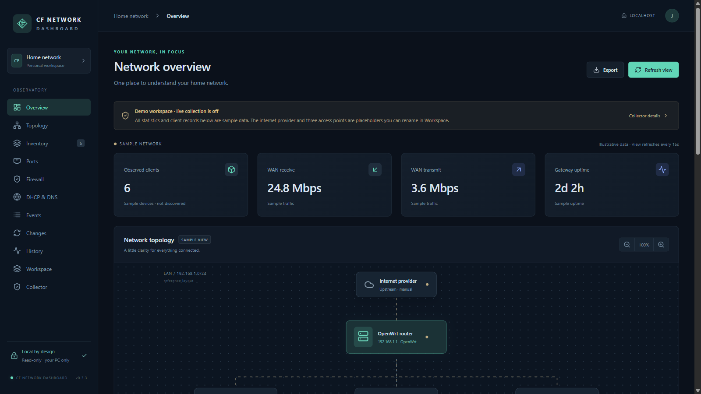
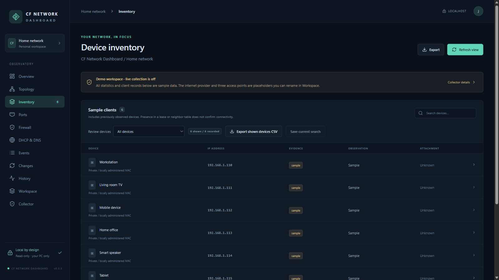
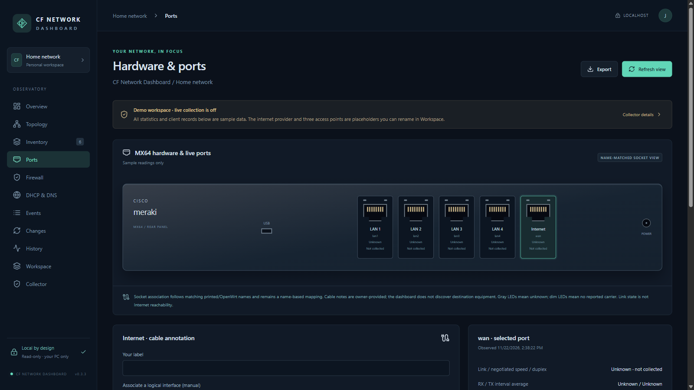

# CF Network Dashboard

A local, read-only dashboard for OpenWrt routers. It shows what your router reports (connected devices,
interfaces, WAN traffic, ports, firewall and DHCP settings) and keeps the recent history. Everything runs on your own
computer: no account, no cloud service, no telemetry. It never changes your router.

MIT-licensed. Made by [Cypress Forge](https://cypressforge.dev).



| Device inventory | Ports |
| --- | --- |
|  |  |

Screenshots use the built-in demo data; nothing here is a real network.

## What it shows
- **Overview and topology:** router, internet provider and access points, with evidence labels that say what was
  observed and what is only a placeholder you added.
- **Inventory:** every device seen in DHCP leases and the neighbor table, with first and last seen, addresses, and your
  own names, icons, tags and notes. An offline vendor lookup works from the MAC address; nothing leaves the PC.
- **Ports:** a rear-panel schematic with your labels for each port, plus link state and speed when port reads are on.
  The schematic is drawn for the Meraki MX64 running OpenWrt, the hardware it was built and tested on.
- **Firewall and DHCP & DNS:** the configured rules, port forwards, DHCP pools and static leases, read-only.
- **Events, Changes and History:** a timeline of devices appearing and leaving, address and interface changes,
  reboots and collector failures; comparisons between two snapshots; WAN and system trends.
- **Workspace:** saved searches, attention thresholds, CSV exports, and a backup and restore of your annotations.

Demo mode shows sample data so you can look around before connecting a router.

## What it never does
- No writes to the router: no UCI changes, service restarts, packages, pings, scans or probes.
- Each read is a fixed command from a short list (below). A gate script on the router refuses anything else.
- Serves only on `127.0.0.1`. Requests from other machines, other hostnames and other origins are refused, and the
  HTTP API is GET-only.
- No passwords are stored. The collector uses its own SSH key, limited by the router to the dashboard's reads.

## Requirements
- An OpenWrt router you can log in to over SSH (tested on OpenWrt 25.12 on a Meraki MX64).
- Windows 10 or 11 with PowerShell, or Linux (tested on Debian 13).
- Python 3.11+, Node.js 20.19+ or 22.12+ with npm (to build the frontend once), and an OpenSSH client (built into
  Windows 10/11; `openssh-client` on Linux).

## Install and run

From the project folder in PowerShell:

```powershell
.\scripts\setup.ps1
```

Then double-click **Start Dashboard.cmd** (or run `.\scripts\start.ps1`) and open <http://127.0.0.1:8765>.
It starts in demo mode. Keep its window open; closing it stops the dashboard.

If your PowerShell policy blocks scripts, the equivalent commands are:

```powershell
python -m venv .venv
.\.venv\Scripts\python.exe -m pip install -r requirements.txt
cd frontend; npm ci; npm run build; cd ..
.\.venv\Scripts\python.exe -m uvicorn backend.main:app --host 127.0.0.1 --port 8765 --no-proxy-headers
```

### On Linux

```sh
./scripts/setup.sh                # checks Python/Node, creates .venv, builds the frontend
./scripts/start.sh                # serves http://127.0.0.1:8765 until Ctrl+C (demo mode at first)
./scripts/connect-router.sh       # the same guided router connection as below
```

`setup.sh` never runs `sudo`: if Python's `venv` module or Node.js is missing, it prints the `apt`/`dnf` command to
install it. On Debian 13, `sudo apt install python3-venv nodejs npm` is enough.

To keep it running in the background (at login, or at boot with linger) instead of in a terminal:

```sh
./scripts/install-service.sh      # systemd user service; ./scripts/uninstall-service.sh removes it
```

## Connect your router

```powershell
.\scripts\connect-router.ps1
```

It creates a dashboard-only SSH key, installs a gate on the router that allows only this app's reads, writes
`config.local.json` in live mode, and checks that an arbitrary command is refused. You type your router password into
SSH once; it is never stored. Details, revoking access and troubleshooting: [docs/ROUTER-ACCESS.md](docs/ROUTER-ACCESS.md).

Settings live in `config.local.json` (see `config.example.json`):

| Setting | Default | Meaning |
| --- | --- | --- |
| `mode` | `demo` | `live` reads the router |
| `host`, `username`, `identity_file` | `192.168.1.1`, `root`, empty | where and how to connect |
| `poll_seconds` | 60 | collection interval (60 s to 15 min; failures back off up to 15 min) |
| `retention_days` | 7 | history kept, 1–90 days |
| `collect_ports`, `collect_firewall`, `collect_dhcp` | `false` | optional extra reads (turned on by `connect-router.ps1`) |

Restart the dashboard after changing settings.

## What it reads

Every interval, one SSH session runs these fixed commands:

```text
ubus call system board
ubus call system info
ubus call network.interface dump
cat /tmp/dhcp.leases
ip -4 neigh show
cat /proc/net/dev
```

The optional reads are `ubus call network.device status` (ports), `cat /etc/config/firewall` and
`nft -j -a list ruleset` (firewall), and `cat /etc/config/dhcp` (DHCP). An observation is stored only when all reads
parse. A DHCP lease or a neighbor entry does not prove a device is online, and the dashboard doesn't claim it does.
WAN rates come from byte-counter changes on the `wan` interface and need two samples.

## Data and backups
- History is stored in `data/history.sqlite3`. Treat it and any exports as private network inventory.
- `.\.venv\Scripts\python.exe -m backend.cli backup` writes a consistent copy to `backups/`, even while the
  dashboard is running.
- Your names, notes and topology labels stay in this browser's local storage, separate for demo and live mode. Use
  Workspace → backup to move them to another browser.

## Add-ons

The dashboard loads optional add-ons through a small, documented seam (`backend/addons.py`). Add-ons can add pages,
API routes and a theme. See [docs/ADDON-DESIGN.md](docs/ADDON-DESIGN.md) and the example in `examples/hello`.
[CF Dashboard Plus](https://cypressforge.dev/dashboard) is a paid add-on with years of history, alerts to your phone,
email or desktop, and accent colours.

## Tests

```powershell
.\scripts\test.ps1
```

On Linux: `./scripts/test.sh`. Every pull request also runs the tests on Linux (GitHub Actions).

This runs the backend tests (`python -m unittest discover -s tests`) and the frontend tests and build
(`cd frontend; npm test; npm run build`). On native Windows, the `test_router_access` tests that run the generated
router gate need a POSIX `sh`, so they error there; run them on Linux or WSL.

## Architecture
- `backend/collector.py`: the OpenWrt adapter (fixed reads, parsing, a normalized snapshot).
- `backend/store.py`: SQLite storage, rates and retention.
- `backend/main.py`: the cached GET-only API and static files.
- `backend/cli.py`: verify, diagnose, backup and router-gate tools.
- `frontend/`: React and TypeScript, built once with Vite and served by FastAPI.

## License

MIT, see [LICENSE](LICENSE). Dependencies keep their own licenses.

The MIT license covers the code. It does not grant rights to the names "CF Network Dashboard", "CF Dashboard Plus" and
"Cypress Forge", or to the CF emblem (`frontend/src/CfEmblem.tsx` and the tab icon). Forks should use their own name
and icon.
